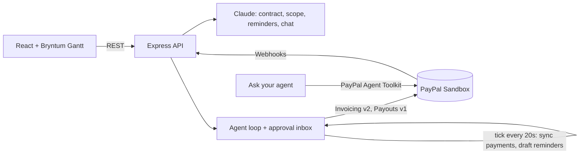

# Paid to Proceed - work gets done, money gets paid, in that order

**Paid to Proceed is an AI back-office agent for freelancers who bill overseas clients through PayPal.**
You drop in a contract. Paid to Proceed turns it into a project timeline where every phase ends in a **PayPal payment gate**. It checks each deliverable against the contract, sends the PayPal invoice, chases late payments politely, and pays your subcontractors once the client pays. It never moves money without your approval.

> Built for the [PayPal AI Hackathon 2026](https://paypalaihackathon.devpost.com/). Everything runs on the **PayPal sandbox**.

### What's different
- **Late payments show up as schedule slip.** Payment gates are real tasks in the project schedule, so an unpaid invoice visibly pushes every later phase back, compared against the original plan. The cost of paying late is on screen, not buried in a spreadsheet.
- **A collections agent, not just an invoice generator.** Reminders escalate from friendly to firm to final, and go out through PayPal Invoicing only after you approve them.
- **For clients you already have.** You upload the contract you already signed. There's no marketplace to join, and the client doesn't have to pre-fund escrow. They just pay a normal PayPal invoice.
- **Your team gets paid when you do.** Subcontractor shares in the contract become PayPal Payouts the moment the client's payment lands.

---

## The problem

Millions of independent freelancers get paid by clients in other countries, and PayPal is how many of them get paid. The work is milestone-based, but the money side is handled by hand:

- You finish a phase, write an invoice, and wait.
- The client goes quiet. Chasing them feels awkward, so you wait longer.
- You start the next phase anyway, because the deadline doesn't move. Now you're funding the client's project.
- Your illustrator or tester waits too, because you haven't been paid yet.

Project tools track tasks and payment tools track money, but **nothing connects the two**.

## What Paid to Proceed does

| Step | What happens | PayPal / AI |
|---|---|---|
| **1. Contract → plan** | Upload a PDF or paste a contract. Paid to Proceed extracts milestones, amounts, acceptance criteria, subcontractor splits and payment risks, then draws a Gantt where each phase ends in a payment gate. | Claude (PDF understanding + structured outputs) |
| **2. Deliverable → scope check** | Describe what you delivered. Claude checks it against each acceptance criterion and writes the client-facing invoice note. | Claude |
| **3. Approve → invoice** | An invoice proposal lands in your **Agent inbox**. Edit it, approve it, and it becomes a real invoice sent through PayPal. | PayPal Invoicing v2 |
| **4. Payment → unlock** | Paid to Proceed learns about the payment through a PayPal webhook, or by polling PayPal when no webhook is set up. The gate turns green and the next phase unlocks. | PayPal Webhooks + Invoicing |
| **5. Late → re-plan + remind** | When an invoice is overdue, the Bryntum scheduling engine pushes every later phase right. The slip shows against the original plan, and the delivery-date KPI updates. Claude drafts a reminder whose tone escalates over time (friendly, then firm, then final). You approve it and PayPal sends it. | Bryntum Gantt + Claude + PayPal Invoicing reminders |
| **6. Paid → pay the team** | When a client pays, Paid to Proceed proposes each subcontractor's share (from the contract) as a PayPal Payout. | PayPal Payouts v1 |
| **Ask your agent** | A chat agent that can answer questions like "Who owes me money?" or "Has the Harbor & Pine invoice been paid?" using live PayPal data, and can queue reminders or invoices for your approval. | Claude tool use + **PayPal Agent Toolkit** |

**Human in the loop by design.** Every action that moves money or emails a client goes into an approval inbox, where you can edit the amount, subject and message. Failed actions stay in the inbox with the error so you can retry.

## How PayPal is used

| Capability | API | Where |
|---|---|---|
| Create, number and send invoices | `POST /v2/invoicing/generate-next-invoice-number`, `POST /v2/invoicing/invoices`, `POST /v2/invoicing/invoices/{id}/send` | [server/paypal.ts](server/paypal.ts) |
| Payment status + payer link | `GET /v2/invoicing/invoices/{id}` | Polling every 20s in [server/agent.ts](server/agent.ts) |
| Escalating reminders | `POST /v2/invoicing/invoices/{id}/remind` | Approved reminder actions |
| Record a payment (demo shortcut) | `POST /v2/invoicing/invoices/{id}/payments` | "Simulate payment" button |
| Pay subcontractors | `POST /v1/payments/payouts`, `GET /v1/payments/payouts/{id}` | Approved payout actions |
| Real-time updates | Webhooks `INVOICING.INVOICE.PAID`, `PAYMENT.PAYOUTSBATCH.*` + `POST /v1/notifications/verify-webhook-signature` | `/api/webhooks/paypal` |
| Agent tools | **@paypal/agent-toolkit**: `list_invoices`, `get_invoice`, `list_transactions`, `list_disputes`, `get_dispute` | [server/copilot.ts](server/copilot.ts) |

## How AI is used

All AI runs on **Claude** (`claude-opus-5-5`) through the official Anthropic TypeScript SDK ([server/ai.ts](server/ai.ts), [server/copilot.ts](server/copilot.ts)):

- **Contract extraction:** reads a PDF directly as a document block and returns a typed plan (Zod schema, structured outputs). It reads milestones, amounts, acceptance criteria, task durations, subcontractor splits and payment risks.
- **Scope check:** grades a submission against each acceptance criterion, with evidence, and writes the invoice note.
- **Reminder drafting:** the tone escalates with the number of reminders already sent and how late the payment is. It never threatens and never invents late fees.
- **Ask your agent agent:** the SDK tool runner over app tools plus the PayPal Agent Toolkit's read-only tools. Tools that would move money can only *propose* an action into the inbox.
- Server-side refusal fallbacks are on (`fallbacks: "default"`).

## Sponsor tools

- **Bryntum Gantt** (trial): payment gates are real Gantt tasks with dependencies, so Bryntum's scheduling engine moves every later phase when a gate stays open. **Baselines** show the original plan as a shadow under each bar, so the cost of a late payment is visible. Also uses time ranges for the demo-clock "Today" line, a custom task renderer and custom tooltips.
- **Render**: one-click deploy with [render.yaml](render.yaml).

## Architecture



## Run it locally

**Requirements:** Node.js 20+, a free [PayPal Developer](https://developer.paypal.com/) account, and an [Anthropic API key](https://console.anthropic.com/).

1. **PayPal sandbox setup** (in the [Developer Dashboard](https://developer.paypal.com/dashboard/)):
   - Go to **Apps & Credentials → Sandbox → Create App** (Merchant), and copy the Client ID and Secret.
   - Go to **Testing Tools → Sandbox Accounts** and note two *Personal* account emails. One is the **client** who pays invoices; the other is the **subcontractor** who receives payouts. You'll use the client account's password to pay invoices on the sandbox payer page.
2. **Configure:**
   ```bash
   cp .env.example .env    # then fill in the values
   ```
3. **Install and run:**
   ```bash
   npm install
   npm run dev             # web on http://localhost:5173, API on :8787
   ```
4. Open http://localhost:5173. A demo project is seeded automatically.
5. Optional: with the app running, `npm run test:e2e` runs the whole flow against the PayPal sandbox and Claude (about 1 minute).

**Optional, real-time webhooks:** expose the API (e.g. deploy to Render), add a webhook in your sandbox app pointing to `https://<host>/api/webhooks/paypal` for `Invoice paid` and `Payouts batch` events, and set `PAYPAL_WEBHOOK_ID`. Without webhooks, Paid to Proceed polls PayPal every 20 seconds.

## 3-minute demo script (also how judges can test)

> **Live demo note:** the hosted demo runs on Render's free plan. If nobody has visited for about 15 minutes, the first load can take **up to a minute** while the server wakes up. After that it's fast. Waking up also resets the demo data, so you always start from a clean Harbor & Pine project.

1. **Demo project:** Harbor & Pine Physiotherapy (Seattle) hires Ananya, a designer-developer in Bengaluru. The contract is $4,500 in three phases, and two subcontractors are paid out of the milestones.
2. **Phase 1 → Submit deliverable → "Use sample submission" → Run scope check.** Claude checks each criterion, and an invoice proposal appears in the inbox.
3. **Approve & send invoice.** A real PayPal sandbox invoice is created and sent. The gate turns amber.
4. Press **+7d, then +3d** on the demo clock. The invoice is now overdue: the gate turns red, phases 2 and 3 slide right past their baseline, and the delivery date KPI slips. Claude drafts a friendly reminder. **Approve** it and PayPal sends it.
5. **Get paid:** click **Pay as client** and pay with the sandbox client account, or click **Simulate payment**. The gate turns green, phase 2 unlocks, and a **PayPal Payout** to Meera (25%) is proposed. Approve it.
6. Open **Ask your agent**: "Check PayPal: has the latest invoice been paid?"
7. **New from contract → Use sample contract** (or upload any PDF) to watch Claude build a plan from scratch.

> Use **Reset demo data** in the sidebar at any time.

## Project structure

```
server/
  index.ts     REST API, webhook endpoint, background watcher
  agent.ts     agent loop: proposals, approvals, payment sync, reminders, payouts
  ai.ts        Claude: contract extraction, scope check, reminder drafting
  copilot.ts   "Ask your agent" tool-using agent (+ PayPal Agent Toolkit)
  paypal.ts    PayPal REST client (Invoicing v2, Payouts v1, webhook verification)
  gantt.ts     payment-gated schedule + baselines → Bryntum data
  demo.ts      sample contract + seeded demo project
src/
  App.tsx      dashboard, inbox, activity, modals, chat drawer
  Timeline.tsx Bryntum Gantt wrapper
```

## Notes and limits

- **Sandbox only.** No real money moves. This is a hackathon prototype: there's no auth, it's single-tenant, and it uses JSON-file storage.
- "Simulate payment" records an external payment on the PayPal invoice through the API. Use it when you don't want to log in as the sandbox buyer.
- The demo clock shifts the app's "today" so overdue handling can be shown live. PayPal still sees real time.

## License

MIT. See [LICENSE](LICENSE).
